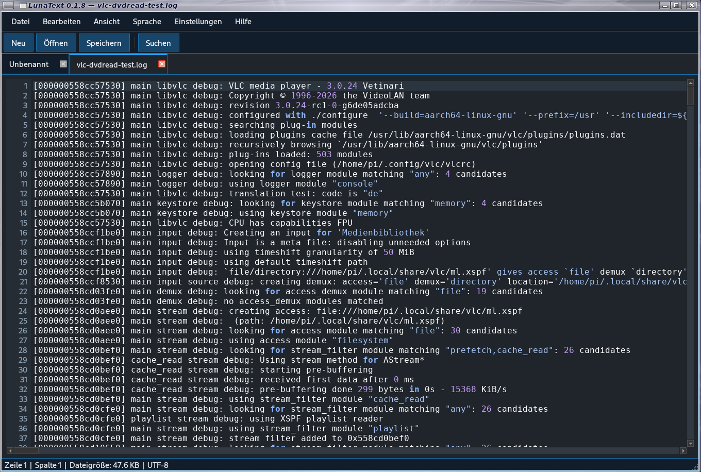

# LunaText 0.1.11

**LunaText** ist ein tabbasierter Texteditor auf Basis von Python 3, Qt 6 und
PySide6. Diese Ausgabe ist für Debian 13 (Trixie) und Systeme wie den
Raspberry Pi mit ARM64 ausgelegt.



[Github Seite](https://github.com/Angonikro/LunaText/)

## Inhalt

- [Funktionen](#funktionen)
- [Bedienung](#bedienung)
- [Einstellungen und Speicherort](#einstellungen-und-speicherort)
- [Systemvoraussetzungen](#systemvoraussetzungen)
- [Installation des DEB-Pakets](#installation-des-deb-pakets)
- [Start aus dem Quellcode-ZIP](#start-aus-dem-quellcode-zip)
- [Deinstallation](#deinstallation)
- [Fehlerdiagnose](#fehlerdiagnose)
- [Projektstruktur](#projektstruktur)

## Funktionen

- Mehrere Dokumente gleichzeitig in Tabs bearbeiten
- Tabs wechseln, verschieben und einzeln schließen
- Neue Dateien erstellen sowie Dateien öffnen, speichern und unter einem
  anderen Namen speichern
- Textdateien und viele Quellcode-/Konfigurationsformate öffnen (unter anderem TXT, MD, LOG, CONF, INI, CFG, SH, PY, JS, CSS, HTML, XML, JSON, YAML, TOML, CSV, SQL, C/C++, Java, PHP, Perl, Ruby, Rust, Diff und Patch)
- Dateizuordnungen für alle von LunaText registrierten Text- und Quellcodeformate; bei der Paketinstallation wird LunaText für diese MIME-Typen als Standardanwendung des installierenden Desktop-Benutzers gesetzt
- Textdateien mit UTF-8 lesen und schreiben
- Rückgängig und Wiederholen
- Ausschneiden, Kopieren, Einfügen und Alles auswählen
- Text suchen, einzeln ersetzen und alle Treffer ersetzen
- Python-Syntaxhervorhebung
- Zeilennummern und automatische Einrückung
- Statusleiste mit Zeile, Spalte, Dateigröße und Zeichencodierung
- Werkzeugleiste und Statusleiste über **Ansicht** ein- und ausschalten
- Kontextmenü und Tastenkürzel
- Deutsche und englische Programmoberfläche
- Helles und dunkles Farbschema
- Schriftgröße und Schriftfarbe einstellen
- Fenstergröße auf Wunsch speichern
- Warnung bei ungespeicherten Änderungen
- Bereits laufende Instanz übernimmt zusätzlich geöffnete Dateien

## Bedienung

### Menüs

- **Datei:** Neu, Öffnen, Speichern, Speichern unter, Tab schließen, Beenden
- **Bearbeiten:** Rückgängig, Wiederholen, Ausschneiden, Kopieren, Einfügen,
  Alles auswählen, Suchen und Ersetzen
- **Ansicht:** Werkzeugleiste, Statusleiste sowie helles und dunkles Theme
- **Sprache:** Deutsch oder Englisch
- **Einstellungen:** Fenstergröße merken, Schriftgröße und Schriftfarbe
- **Hilfe:** Informationen zu LunaText

### Tastenkürzel

| Aktion | Tastenkürzel |
|---|---|
| Neue Datei | `Strg` + `N` |
| Datei öffnen | `Strg` + `O` |
| Speichern | `Strg` + `S` |
| Speichern unter | `Strg` + `Umschalt` + `S` |
| Tab schließen | `Strg` + `W` |
| Rückgängig | `Strg` + `Z` |
| Wiederholen | `Strg` + `Umschalt` + `Z` |
| Ausschneiden | `Strg` + `X` |
| Kopieren | `Strg` + `C` |
| Einfügen | `Strg` + `V` |
| Alles auswählen | `Strg` + `A` |
| Suchen | `Strg` + `F` |
| Ersetzen | `Strg` + `H` |

## Einstellungen und Speicherort

Die Einstellungen werden über `QSettings` unter der Organisation **Goldisoft**
und dem Programmnamen **LunaText** gespeichert. Unter Linux liegt die Datei
üblicherweise hier:

```text
~/.config/Goldisoft/LunaText.conf
```

Dort speichert LunaText unter anderem Sprache, Theme, Schriftgröße,
Schriftfarbe und – wenn aktiviert – die Fenstergröße.

## Systemvoraussetzungen

- Debian 13 (Trixie) oder eine kompatible Debian-basierte Distribution
- Python 3
- PySide6 aus den Debian-Paketquellen
- Für die grafische Oberfläche eine laufende Desktop-Sitzung

Die benötigten Python-/Qt-Komponenten sind:

- `python3`
- `python3-pyside6.qtwidgets`
- `python3-pyside6.qtnetwork`

Es wird keine virtuelle Python-Umgebung angelegt. LunaText installiert keine
Abhängigkeiten über `pip`.

## Installation des DEB-Pakets

Im Terminal in den Ordner wechseln, in dem die DEB-Datei liegt. Anschließend:

```bash
sudo apt update
sudo apt install ./lunatext_0.1.11_all.deb
```

`apt` installiert dabei bei Bedarf auch die in den Paketinformationen
angegebenen Abhängigkeiten.

Nach der Installation kann LunaText auf zwei Arten gestartet werden:

1. Über den Eintrag **LunaText** im Anwendungsmenü.
2. Im Terminal mit:

```bash
lunatext
```

Eine oder mehrere Dateien können auch direkt beim Start übergeben werden:

```bash
lunatext datei.txt
lunatext datei1.txt datei2.txt
```

## Start aus dem Quellcode-ZIP

### 1. ZIP-Datei entpacken

Zum Beispiel im Download-Ordner:

```bash
cd ~/Downloads
unzip LunaText_0.1.11_GITHUB.zip
cd LunaText_0.1.11
```

### 2. Abhängigkeiten installieren

```bash
sudo apt update
sudo apt install python3 python3-pyside6.qtwidgets python3-pyside6.qtnetwork
```

### 3. Programm starten

```bash
chmod +x run.sh
./run.sh
```

Alternativ kann LunaText direkt über Python gestartet werden:

```bash
python3 lunatext/main.py
```

Eine Datei lässt sich auch beim Start übergeben:

```bash
./run.sh ~/Dokumente/notizen.txt
```

### 4. DEB-Paket selbst bauen (optional)

Im ZIP ist das Debian-Paketverzeichnis `debian/` enthalten. Zum Bauen wird
`dpkg-deb` benötigt:

```bash
sudo apt install dpkg
chmod +x build_deb.sh
./build_deb.sh
```

Das erzeugte Paket liegt anschließend im Projektordner. Der Dateiname enthält
die Versionsnummer aus `debian/DEBIAN/control`.


## Deinstallation

Das installierte DEB-Paket kann mit folgendem Befehl entfernt werden:

```bash
sudo apt remove lunatext
```

Die persönlichen Einstellungen in `~/.config/Goldisoft/LunaText.conf` werden
durch `apt remove` normalerweise nicht entfernt. Zum vollständigen Entfernen
des Pakets einschließlich systemweiter Paket-Konfigurationsdateien kann
stattdessen verwendet werden:

```bash
sudo apt purge lunatext
```

Auch dabei wird die persönliche QSettings-Datei im Home-Verzeichnis nicht
automatisch gelöscht.

## Fehlerdiagnose

Wenn LunaText nicht startet, kann die Fehlermeldung im Terminal angezeigt
werden:

```bash
lunatext
```

Bei einem Start aus dem entpackten Quellcode:

```bash
cd ~/Downloads/LunaText_0.1.11
python3 lunatext/main.py
```

Fehlen PySide6-Module, können die Abhängigkeiten erneut installiert werden:

```bash
sudo apt install --reinstall python3-pyside6.qtwidgets python3-pyside6.qtnetwork
```

## Projektstruktur

```text
LunaText_0.1.11/
├── lunatext/
│   ├── __init__.py
│   ├── __main__.py
│   └── main.py
├── debian/
│   ├── DEBIAN/
│   │   ├── control
│   │   └── postinst
│   └── usr/
│       ├── bin/lunatext
│       ├── share/applications/lunatext.desktop
│       ├── share/icons/hicolor/scalable/apps/lunatext.svg
│       └── share/lunatext/
├── run.sh
├── build_deb.sh
├── README.md
└── CHANGELOG.md
```

## Lizenz und Hinweise

Diesem Quellcode-Paket liegt keine separate Lizenzdatei bei. Vor einer
Weiterveröffentlichung sollte eine passende Lizenz ergänzt werden.

Die README beschreibt die enthaltene Version 0.1.11. Änderungen und
Versionshinweise stehen in `CHANGELOG.md`.

## Dateitypen in Caja („Öffnen mit“)

LunaText registriert sich für normale Textdateien sowie Markdown-, Python-,
Shell-, CSV-, XML-, JSON- und HTML-Dateien. Nach der Installation wird der
Desktop-MIME-Cache aktualisiert und LunaText für alle im Desktop-Eintrag registrierten MIME-Typen als Standardanwendung des installierenden Benutzers eingetragen. Das umfasst auch Shell-Skripte (`.sh`). In Caja kann die Zuordnung bei Bedarf über **Rechtsklick →
Öffnen mit → LunaText** ausgewählt werden.

73 de DO2QG Andreas
